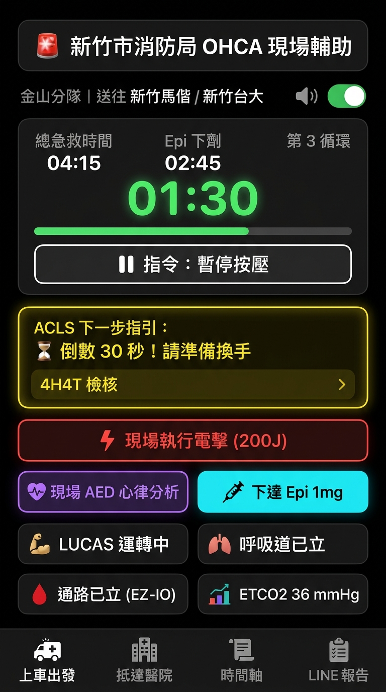
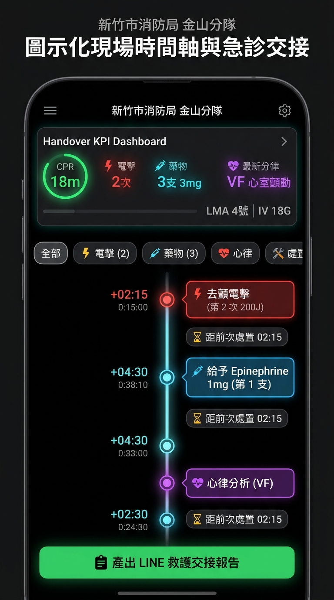
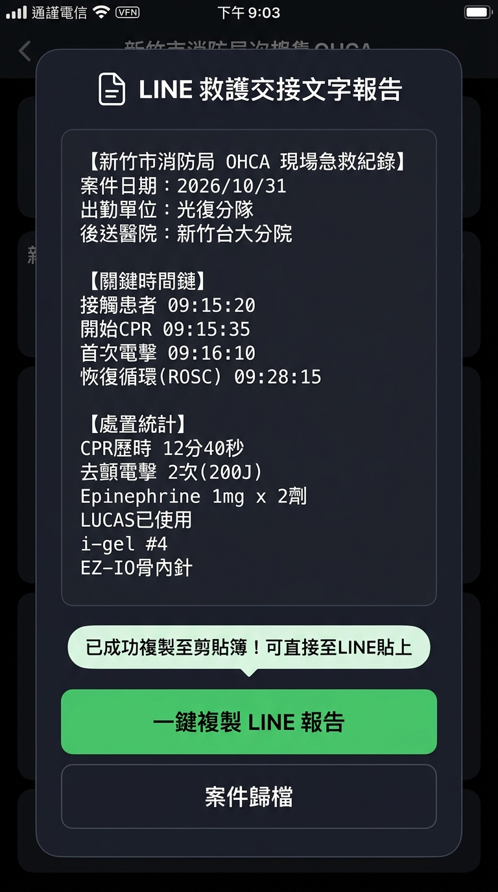

# 新竹市消防局到院前救護 OHCA 現場紀錄與決策輔助 App

專為**高壓、吵雜、分秒必爭之 OHCA 急救現場**設計的手機應用程式，專注於協助現場指揮官（Leader）與救護技術員（EMT）精準掌握 CPR 循環節奏、給藥時間點與下一步 ACLS 決策。


---

## 📱 App 核心畫面說明 (Screen Previews)

| 1. 急救主操作與 Leader 指令卡 | 2. 捷運圖連續時間軸 (Metro Rail) | 3. 一鍵 LINE 救護報告交接 |
| :---: | :---: | :---: |
|  |  |  |
| **金山分隊專屬主畫面**<br>• 指令驅動 CPR 2分鐘倒數<br>• 動態 ACLS 決策指引卡<br>• Epinephrine 給藥冷卻指示<br>• LUCAS、SGA、IV/IO 處置鍵 | **圖示化連續時間軸**<br>• 站點式時間軸（接觸➔CPR➔電擊➔ROSC）<br>• 急診交接儀表板（總按壓時間/Shock/Epi）<br>• 快速檢視關鍵醫療處置節點 | **新竹市工作群組通報**<br>• 符合消防局標準救護通報格式<br>• 一鍵複製至剪貼簿<br>• 包含完整急救時間鏈與統計摘要 |

---

## 🌟 核心特色 (現場指令驅動設計)

1. **現場指令驅動倒數 (Leader Command-Driven Timing)**：
   - **絕不擅自跳轉或盲目空轉**：所有 CPR、AED 心律分析、電擊與給藥時間點，皆由現場指揮官（Leader）於聽到/下達現場口令後點擊記錄。
   - **指令下達後啟動倒數**：點擊「指令下達：開始 CPR」即刻精確記錄時間並啟動 2 分鐘倒數；點擊「現場 AED 分析」立即記錄分析時間並暫停按壓計時；點擊「現場執行電擊」精確記錄電擊時間，提示 Leader 下達「立即恢復按壓」，並在按下恢復時重啟下一輪 120 秒倒數。
   - **2 分鐘循環超時警示**：若 2 分鐘循環已滿但現場尚未分析心律，App 顯示超時秒數（如 `+00:15`）並語音警示，等待 Leader 現場指令。
2. **動態 ACLS 決策指引卡**：
   - 即時根據心律判定（VF/pVT vs PEA/Asystole）與電擊/給藥進度，動態顯示下一步處置建議。
   - 4H4T 可逆病因一鍵檢核抽屜。
3. **Epinephrine 智慧冷卻計時**：
   - Leader 下達給藥指令後點擊，記錄時間並啟動 4 分鐘倒數，T-30s 預告、T-0s 提示可下達下一劑。
4. **新竹市專屬裝備與進階處置**：
   - **LUCAS 2/3** 自動心肺復甦機上機與運轉計時。
   - **EZ-IO 骨內針** 與周邊靜脈（IV）穿刺部位快速標記。
   - **SGA (i-gel) / ETT 氣管插管**（含視訊喉頭鏡與深度設定）。
   - **ETCO2 連續數值監測**（突升自動提示 ROSC 評估）。
5. **一鍵複製 LINE 救護通報格式**：
   - 符合新竹市消防局救護工作群組格式，包含完整時間鏈（接觸、CPR、電擊、上車、到院、ROSC）與統計清單。

---

## 📁 專案架構 (Flutter Layered Architecture)

```text
OHCA App/
├── lib/
│   ├── main.dart                                # 應用程式進入點 (鎖定直向、暗色主題)
│   ├── domain/
│   │   ├── models/
│   │   │   ├── rhythm_type.dart                 # 心律類型 (VF, pVT, PEA, Asystole, ROSC)
│   │   │   ├── cpr_event.dart                   # 急救事件模型
│   │   │   ├── ohca_session.dart                # 完整案件資料模型
│   │   │   └── decision_guidance.dart           # 決策指引模型
│   │   └── engine/
│   │       └── ohca_decision_engine.dart        # ACLS 臨床決策演算法
│   ├── data/
│   │   ├── services/
│   │   │   ├── tts_service.dart                 # 中文語音播報服務
│   │   │   ├── vibration_service.dart           # 觸覺與強烈震動回饋
│   │   │   └── line_report_formatter.dart       # LINE 報告格式產生器
│   │   └── repositories/
│   │       └── session_repository.dart          # 本機離線儲存與歸檔
│   └── ui/
│       ├── core/
│       │   └── app_colors.dart                  # 高對比救護專用顏色庫
│       └── features/
│           ├── active_cpr/
│           │   ├── view_models/
│           │   │   └── active_cpr_view_model.dart # 核心狀態機與計時器
│           │   └── views/
│           │       ├── active_cpr_screen.dart   # 急救操作主畫面
│           │       └── widgets/                 # 計時卡、決策卡、處置面板、彈窗
│           └── timeline/
│               └── views/
│                   └── timeline_sheet.dart      # 時間軸檢視與回放
├── test/
│   ├── ohca_decision_engine_test.dart           # 決策引擎單元測試
│   └── line_report_formatter_test.dart          # 報告格式化測試
└── web/
    └── index.html                               # 獨立即時網頁預覽 (免安裝 Flutter 即可立即測試)
```

---

## 🚀 快速啟動方式

### 方法 A：直接以瀏覽器即時體驗 (推薦立即試用)
只需在終端機執行或直接雙擊開啟 `web/index.html`：
```bash
python3 -m http.server 8080 -d web
```
開啟瀏覽器前往 `http://localhost:8080`，即可完整體驗語音合成、倒數計時、LUCAS、處置按鍵與 LINE 報告產生！

### 方法 B：以 Flutter 編譯為 iOS / Android 原生 App
在已安裝 Flutter SDK 的環境中：
```bash
# 取得套件依賴
flutter pub get

# 執行單元測試
flutter test

# 於手機或模擬器上啟動
flutter run

# 打包 Android APK
flutter build apk --release

# 打包 iOS
flutter build ios --release
```
